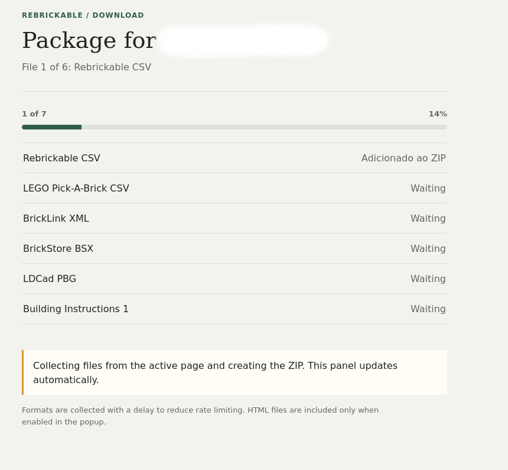

# Rebrickable MOC Downloader

A Firefox extension that collects inventory exports from a Rebrickable MOC page and combines them into a ZIP file.

## Requirements and compatibility

Firefox 140 or later on desktop, or Firefox for Android 142 or later, is required, along with an active Rebrickable session in the same Firefox profile. These versions provide the built-in data-transmission consent prompt declared by this extension. The extension works on an open MOC page on `rebrickable.com`; it does not search for MOCs or bypass authentication, rate limits, or site security checks.

## Installation

### Temporary installation for testing

1. In Firefox, open `about:debugging#/runtime/this-firefox`.
2. Click **Load Temporary Add-on…** and select this folder's `manifest.json` file.
3. Sign in to Rebrickable in the same Firefox profile.
4. Open a MOC page, for example `https://rebrickable.com/mocs/MOC-123456/`, and click the extension icon. The extension detects the ID from the active tab URL and opens a progress tab while collecting exports from the MOC page.

Temporary add-ons are intended for development and testing and are removed when Firefox closes. For permanent installation, the extension must be signed by Mozilla and distributed, for example through [Firefox Add-ons (AMO)](https://addons.mozilla.org/firefox/). A permanent installation link will be added here after publication.

## Exported files

By default, the ZIP file `MOC-ID.zip` includes Rebrickable CSV, LEGO Pick-A-Brick CSV, BrickLink XML, BrickStore BSX, and LDCad PBG. **Include all building instruction files in ZIP** is enabled by default and includes files available under **Download the free Building Instructions**. Uncheck it in the popup to exclude them. **Include HTML exports (Table and Grid)** adds both HTML exports; this preference is saved for future use.

Exports are collected with a 15-second delay between requests. The progress tab shows each file's status. If a request fails, the queue continues where possible and may create a partial ZIP containing successfully retrieved files. If the server returns HTTP 429, the queue stops.

## Limitations and troubleshooting

- **The download will not start or exports are missing:** Make sure the active tab is a Rebrickable MOC page and the inventory has finished loading. If needed, reload the page, check that the MOC offers exports, and try again.
- **Redirected to login or session error:** Sign in to Rebrickable in the same Firefox profile and start again. BrickLink XML also requires this session.
- **HTTP 429:** Rebrickable has rate-limited requests. The queue stops and does not retry automatically; wait before starting another download.
- **Missing instructions:** Some attachments require manual verification, such as Turnstile. The extension cannot complete this check or include its response in the ZIP. Open the attachment on the site and complete the check manually.
- **Download failed or ZIP is incomplete:** Check each item's status in the progress tab and Firefox's downloads list. Confirm Firefox allows downloads and that disk space is available. Retry only after addressing the cause and observing any rate limit indicated by the site.

## Permissions and privacy

- `tabs`: detect the MOC page in the active tab and track navigation and progress.
- `downloads`: save the BrickLink XML file through the extension's download flow.
- `storage`: save the preference for including HTML exports locally.
- Access to `https://rebrickable.com/*`: read exports and instructions from the MOC page using the existing Firefox session.

When you start a download, the extension requests the selected MOC's exports and instructions from Rebrickable using your existing Firefox session. This involves the MOC page/activity and its content being handled by Rebrickable to fulfil the request. The extension does not send data to its own services or store cookies, passwords, or credentials. The only locally persisted preference is whether to include HTML exports; authentication is managed by Firefox and Rebrickable.

## Reporting an issue

Open an [issue](https://github.com/tugas/Rebrickable-MOC-Downloader/issues) and include the Firefox version, extension version, public MOC ID, steps to reproduce, and the message or stage shown in the progress tab. Mention which formats were selected and whether the issue persists after reloading the page. Remove personal information from screenshots before attaching them.

Never include cookies, authentication headers, passwords, tokens, session data, or other private information. Do not publish inventory or building instruction files belonging to others unless you have permission to share them.

## Development and publishing

Version history will be maintained through [GitHub Releases](https://github.com/tugas/Rebrickable-MOC-Downloader/releases), with notes for each version. The extension is distributed under the MIT License; see [LICENSE](LICENSE). Before submitting to AMO, the publisher must replace the example Gecko ID in `manifest.json` with a stable, unique ID under their control.

To package the extension for submission, run `./package.sh` from this directory. The script requires `zip` or 7-Zip and creates `web-ext-artifacts/rebrickable-moc-downloader.zip`. It also creates `web-ext-artifacts/release-notes-v<VERSION>.md` from Git commit messages since the latest tag (or all commits if there is no tag). Commit changes before packaging so the notes include them; uncommitted changes are not included. If the repository has no commit history, the script marks the package as an initial release. The ZIP contains the manifest, extension JavaScript/HTML/CSS files, README, and license; there is no build or bundling step.
